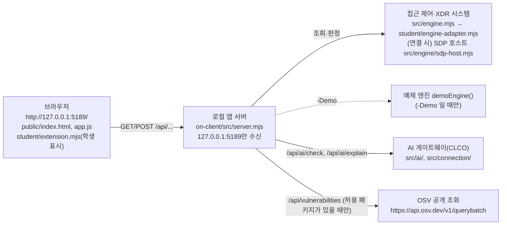

# 슈크림붕어빵 실행 설명서와 시스템 구성도 (학생 문서)

이 문서는 학생이 직접 작성했습니다. 제공 문서(README, STUDENT_LAUNCH_GUIDE.md 등)는 고치지 않았고, 이 문서는 그 내용과 **실제 코드·실제 실행 결과**를 대조해 적었습니다. 직접 실행해서 본 것과 문서·코드를 읽어서만 적은 것, 확인하지 못한 것을 구분해 표시합니다.

표시 기준은 다음과 같습니다.

| 표시 | 뜻 |
|---|---|
| 실행 확인 | 이 프로젝트에서 직접 실행해 출력이나 화면을 봤습니다. |
| 코드 확인 | 실제 파일을 읽어 확인했습니다. 실행하지는 않았습니다. |
| 문서 근거 | 제공 안내 문서에 적혀 있으며 직접 실행해 확인하지 않았습니다. |
| 미확인 | 확인하지 않았습니다. 동작한다고 적지 않습니다. |

## 1. 목적과 기능

- **앱 이름**: 슈크림붕어빵(제공 시작 틀의 앱 이름은 케셰브입니다). 폴더 이름은 `on-client`입니다.
- **목적**: 회사 직원이 자기 로그인 상태, 업무 앱 접속 판정, 최근 접속 기록과 보안 경보, 설치 패키지의 알려진 취약점 조회 결과를 한 화면에서 보는 보안 Agent입니다. AI는 보안 기록의 근거를 설명하고 조치를 제안만 하며, 실제 조치는 실행하지 않습니다.
- **화면(제공 메뉴)**: 「보호 현황」, 「업무 앱」, 「보안 기록」 세 가지입니다(`public/index.html` 코드 확인).
- **학생이 만든 부분**: `student/extension.mjs` 한 파일입니다. 아래 6장 표에 함수별로 정리했습니다.

## 2. 지원 환경과 확인한 버전

| 항목 | 확인한 값 | 상태 |
|---|---|---|
| 운영체제 | Windows 11 Pro 10.0.26200 | 실행 확인 |
| PowerShell | Windows PowerShell 5.1 | 실행 확인 |
| Node.js | v24.22.1 (수업 기준은 24.19.0, `package.json`의 `engines.node`도 24.19.0) | 실행 확인. 24.19.0으로는 실행하지 않았습니다 |
| npm | 11.19.1 | 실행 확인 |
| 외부 npm 패키지 | 없음(`package.json`에 `dependencies`가 없고 `node_modules` 폴더도 없습니다) | 코드 확인 |
| 브라우저 | 앱 화면을 브라우저에서 열어 확인했습니다. 브라우저 종류와 버전은 기록하지 않았습니다 | 미확인 |
| macOS·Linux | 제공 실행 도구가 PowerShell이므로 이 문서는 Windows 기준입니다 | 미확인(지원하지 않음으로 봅니다) |

Node.js 버전이 수업 기준과 다르면 실행 도구가 시작할 때 `참고: 지금 Node.js 는 v24.22.1 입니다. 수업 기준은 v24.19.0 입니다.`라고 알려 주고, 그대로 실행됩니다(실행 확인).

## 3. 폴더 구조

Git 저장소의 최상위는 `on-client`가 아니라 그 위의 프로젝트 폴더입니다(코드 확인: `git rev-parse --show-toplevel` → `C:/Users/User/Documents/keseb-agent`).

```text
C:\Users\User\Documents\keseb-agent\          ← Git 최상위(커밋·제출은 여기 기준)
├─ .gitignore                                  ← .env, node_modules, *.log, receipts/ 는 커밋하지 않음
└─ on-client\                                  ← 앱 폴더(PowerShell을 여는 위치)
   ├─ README.md, package.json, .env.example    ← 제공
   ├─ tools\start-alekov.ps1                   ← 제공: 실행 도구
   ├─ src\server.mjs                           ← 제공: 로컬 앱 서버
   ├─ src\engine.mjs, src\engine\              ← 제공: 접근 제어·XDR 연결 어댑터 로더와 SDP 호스트
   ├─ src\ai\, src\connection\                 ← 제공: AI 연결·계정 연결
   ├─ src\actions\                             ← 제공: 조치 준비·집행·결과 조회
   ├─ src\vulnerabilities\                     ← 제공: OSV 패키지 조회
   ├─ public\ (index.html, app.js, …)          ← 제공: 브라우저 화면과 버튼
   ├─ student\extension.mjs                    ← ★ 학생 작성: 화면 표시 함수 8개
   ├─ student\engine-adapter.mjs               ← 제공 견본(수정하지 않음)
   └─ docs\STUDENT_RUNBOOK.md                  ← ★ 학생 작성: 이 문서
```

## 4. 실행·종료·재실행

### 4-1. PowerShell을 여는 위치

반드시 **앱 폴더 `on-client`** 에서 실행합니다. 다른 폴더(예: `C:\WINDOWS\system32`)에서 실행하면 `-File 매개 변수에 대한 인수 '.\tools\start-alekov.ps1'이(가) 없습니다` 오류가 납니다(실행 확인: 직접 겪음). 폴더 경로만 입력하는 것은 이동이 아니라 "프로그램 실행"이라서 `용어가 cmdlet, 함수, 스크립트 파일 또는 실행할 수 있는 프로그램 이름으로 인식되지 않습니다` 오류가 납니다(실행 확인: 직접 겪음). 이동은 `cd`로 합니다.

```powershell
cd C:\Users\User\Documents\keseb-agent\on-client
```

파일 탐색기에서 `on-client`를 열고 주소 표시줄에 `powershell`을 입력해 여는 방법도 있습니다(문서 근거, 직접 해 보지 않음).

### 4-2. 실행 명령

예제 자료로 화면을 보는 실행입니다(실행 확인).

```powershell
powershell -NoProfile -ExecutionPolicy Bypass -File .\tools\start-alekov.ps1 -Demo
```

`.\tools\start-alekov.ps1`를 `-ExecutionPolicy Bypass` 없이 바로 실행했을 때는 실행되지 않았고, 이 PC의 스크립트 실행 정책 때문으로 봅니다(실행 확인: 직접 겪음. 정확한 오류 문구는 기록하지 않았습니다). `-ExecutionPolicy Bypass`는 이번 한 번의 실행에만 적용되며 PC 보안 설정을 바꾸지 않습니다(코드 확인: `tools/start-alekov.ps1` 머리말).

### 4-3. 정상 시작 신호와 브라우저 주소

`-Demo` 실행에서 아래 출력이 나왔습니다(실행 확인). 맨 앞의 Node.js 참고 줄(2장)은 이 PC의 Node.js가 수업 기준 버전과 달라서 나온 줄입니다. 버전이 같을 때의 출력은 확인하지 않았습니다.

```text
케셰브 예제: http://127.0.0.1:5189
케셰브가 켜졌습니다. 브라우저에서 http://127.0.0.1:5189/ 을 여세요.
서버가 응답한 것만 확인했습니다. AI 연결 상태는 화면에서 따로 확인해 주세요.
끄려면 이 창에서 Ctrl+C 를 누르세요.
```

- 브라우저 주소: `http://127.0.0.1:5189/` (서버가 이 주소의 `/`에 응답 코드 200을 돌려주는 것을 확인했습니다. 실행 확인)
- 위쪽에 "예제 데이터(demo) · 실제 연결 아님" 표시가 보이고 「보호 현황」 화면이 열리면 정상입니다(실행 확인).
- 이 신호는 **내 PC의 서버가 응답했다는 뜻**일 뿐, AI 연결이나 회사 시스템 연결이 성공했다는 뜻이 아닙니다.

### 4-4. 종료와 재실행

| 동작 | 방법 | 상태 |
|---|---|---|
| 종료 | 서버를 실행한 PowerShell 창에서 `Ctrl+C` | 실행 확인(새 PowerShell 창에서 이 문서 4-1~4-3 순서로 켠 뒤 `Ctrl+C`로 종료했고, 종료 뒤 `http://127.0.0.1:5189/`이 응답하지 않는 것을 확인했습니다) |
| 재실행 | 같은 `on-client` 폴더에서 4-2의 명령을 다시 실행 | 실행 확인(같은 명령으로 여러 번 켰습니다) |
| 포트 5189 사용 중 | 명령 끝에 ` -Port 5190`을 붙이고 브라우저 주소도 `:5190`으로 엽니다 | 문서 근거, 미확인 |

### 4-5. 다른 실행 방법

| 방법 | 설명 | 상태 |
|---|---|---|
| `npm run demo` | `node src/server.mjs --demo`와 같은 예제 실행 | 미확인(`package.json`의 scripts만 읽음) |
| `npm start` | `node src/server.mjs` 실행. 연결하지 않은 기본 상태 | 미확인 |
| `-Demo` 없이 `start-alekov.ps1` | 계정 연결용 개인 설정을 Windows 사용자 폴더에 자동 준비한 뒤 실행(제공 도구가 함) | 미확인(개인 설정이 만들어지므로 실행하지 않음) |
| `-NoNativeHost`, `-Background`, `-SdpHostConfig` | 연결 기능 끄기, 창 없이 실행, 담당자 안내 SDP 설정 | 미확인 |
| `npm run check` | `node --check student/extension.mjs`로 학생 파일 문법만 확인 | 실행 확인(오류 없이 끝남) |

## 5. 시스템 구성도 (글로 작성)

### 5-1. Mermaid



### 5-2. ASCII

```text
[브라우저 http://127.0.0.1:5189/]
        │  GET/POST /api/...
        ▼
[로컬 앱 서버 on-client/src/server.mjs  (127.0.0.1 만 수신)]
        │
        ├─ /api/me, /api/apps, /api/events, /api/devices, /api/sessions, /api/access
        │        └→ [접근 제어·XDR 시스템]  src/engine.mjs → student/engine-adapter.mjs → (연결 시) SDP 호스트
        │             · -Demo      : 예제 엔진(demoEngine) 사용
        │             · 연결 없음   : evidenceMode 'disconnected'
        ├─ /api/ai/check, /api/ai/explain
        │        └→ [AI 게이트웨이(CLCO)]  src/ai/, src/connection/
        ├─ /api/actions/prepare, /execute, /result  → 조치 서비스 src/actions/ (지원 조치가 있을 때만)
        └─ /api/vulnerabilities
                 └→ [OSV]  https://api.osv.dev/v1/querybatch  (승인된 공개 패키지가 있을 때만)
```

### 5-3. 요청 경로 표

| 경로 | 방법 | 처리 | 데이터 출처 | 상태 |
|---|---|---|---|---|
| `/api/me`, `/api/apps`, `/api/events`, `/api/devices`, `/api/sessions` | GET | 신원·업무 앱·보안 기록·기기·세션 읽기 | 접근 제어·XDR 엔진(예제 또는 연결) | 예제 모드 화면 확인 / 실제 연결 미확인 |
| `/api/access` | POST | 업무 앱 접속 판정 | 같은 엔진 | 예제 모드 화면 확인 / 실제 연결 미확인 |
| `/api/diagnostics` | GET | 도움정보(비밀값 제외) | 로컬 서버 | 코드 확인 |
| `/api/ai/check` | POST | AI 연결 점검 | AI 게이트웨이 | 화면에서 `ON_AI_PROVISIONING_PENDING`(권한 준비 중) 확인. 연결 성공은 미확인 |
| `/api/ai/explain` | POST | 보안 기록 AI 설명 | AI 게이트웨이 | 화면에서 같은 오류 확인. 설명 성공은 미확인 |
| `/api/actions/prepare`, `/execute`, `/result` | POST | 조치 준비·집행·결과 재조회 | 조치 서비스 | 지원 조치가 없어 실행하지 못함. 미확인 |
| `/api/vulnerabilities` | GET | 설치 패키지 OSV 조회 | OSV | 화면에서 `PROJECT_NOT_CONFIGURED`(조회 준비 미완료) 확인. 실제 조회는 미확인 |

서버는 `127.0.0.1`(내 PC 안)에서만 요청을 받고, 호스트 이름이 `127.0.0.1:포트` 또는 `localhost:포트`일 때만 허용합니다(코드 확인: `src/server.mjs`).

## 6. 구현한 함수와 제공 코드 경계

학생이 만든 것은 `student/extension.mjs`의 화면 표시 함수입니다. 제공 `public/app.js`가 서버 응답을 받아 이 함수에 넘기고, 함수가 돌려준 화면 요소를 칸에 넣습니다. 학생 코드에는 버튼, 서버 요청(POST), 확인 번호가 없습니다.

| 함수 | 단계 | 보여 주는 것 | 제공 코드 경계 | 확인 |
|---|---|---|---|---|
| `renderIdentity` | 13 | 사용자·기기·세션 | 응답 검증과 요청은 제공 | 모의 입력, 예제 화면 |
| `renderDecision` | 14 | 업무 앱 접속 판정과 사유 | 판정은 엔진, 요청은 제공 | 모의 입력, 예제 화면 |
| `renderEvents` | 15 | 접속 기록·XDR 경보 목록과 상세 | 기록 읽기는 제공 | 모의 입력, 예제 화면 |
| `renderStatus` | 16 | 실패·빈 화면·도움정보·미지원 조치 안내 | 도움정보 요청은 제공 | 모의 입력, 예제 화면 |
| `renderAiConnection` | 17 | AI 연결 점검 상태(성공·실패 구분) | 점검 요청·취소·재시도는 제공 | 모의 입력, 실제 화면(권한 준비 중 실패 경로) |
| `renderExplanation` | 17·18 | 근거·규칙·확인 불가 상태·제안과 함께 AI 설명 | 설명 요청과 검증은 제공 | 모의 입력, 실제 화면(실패 경로) |
| `renderAction` | 19 | 조치 제안·확인·접수(ACK)·효과 확인 구분 | 조치 버튼과 요청은 제공 | 모의 입력, 실제 화면(미실행 상태) |
| `renderVulnerabilities` | 20 | 설치 패키지 정확한 버전과 OSV 조회 결과 | 조회 요청과 검증(`vulnerabilities-view.mjs`)은 제공 | 모의 입력, 실제 화면(`not_configured`) |

공통 원칙(코드 확인): 화면은 입력만으로 새로 그리므로 이전 결과가 남지 않습니다. 확인할 수 없는 값은 "확인 불가"로 적고 성공·정상·안전으로 바꾸지 않습니다. 글자는 `createElement`와 `textContent`로만 넣습니다.

## 7. 오류별 확인 순서

| 증상·코드 | 의미 | 확인 순서 | 근거 |
|---|---|---|---|
| `-File 매개 변수에 대한 인수 '.\tools\start-alekov.ps1'이(가) 없습니다` | 앱 폴더가 아닌 곳에서 실행 | 1) 프롬프트의 폴더 확인 2) `cd C:\Users\User\Documents\keseb-agent\on-client` 3) 4-2 명령 다시 실행 | 실행 확인(직접 겪음) |
| `.\tools\start-alekov.ps1`를 바로 실행했을 때 실행되지 않음 | 이 PC의 스크립트 실행 정책이 막은 것으로 봄 | `-ExecutionPolicy Bypass`를 붙인 4-2 명령 사용 | 실행 확인(직접 겪음. 정확한 오류 문구는 기록하지 않았음) |
| `포트 5189 를 다른 프로그램이 쓰고 있습니다` | 포트 충돌 | ` -Port 5190`을 붙이고 주소도 `:5190` | 문서 근거, 미확인 |
| `Node.js 가 없습니다` | Node.js 미설치 | Node.js 설치 후 PowerShell 새로 열기 | 문서 근거, 미확인 |
| `ON_AI_PROVISIONING_PENDING` | 학생 앱 이용 권한 준비 중(학생 잘못 아님) | 1) 연결 점검 성공으로 보지 않기 2) 담당자에게 계정 연결·앱 권한 확인 요청 | 화면 확인 |
| `ALEKOV_CONNECT_UNAVAILABLE` | AI 연결 기능이 서버에 아직 준비되지 않음 | 예제 모드에서는 정상. 담당자 안내를 기다림 | 화면 확인 |
| `NATIVE_HOST_DISABLED`, 확인 불가 | 예전 시작 틀로 연결이 막힘 | 최신 시작 틀 적용은 운영자가 함(학생이 직접 업데이트하지 않음) | 화면 안내 문구, 직접 해결 미확인 |
| `PROJECT_NOT_CONFIGURED` | 패키지 조회 대상 프로젝트 설정 없음 | 설정은 운영자가 준비. 학생이 바꾸지 않음. 취약점 없음이 아님 | 화면 확인 |
| `ENGINE_NOT_CONNECTED` | 접근 제어·XDR 엔진이 연결되지 않음 | 연결 어댑터 확인은 담당자 안내에 따름 | 코드 확인(`src/engine.mjs`) |
| 그 밖의 오류 코드 | — | `docs/CONNECTION_TROUBLESHOOT.md`에서 코드로 찾기. 「보호 현황」의 「도움정보 불러오기」→「확인했으며 복사합니다」로 도움정보를 강사에게 전달 | 문서 근거 |

## 8. 확인한 기능과 미확인 기능

| 구분 | 내용 |
|---|---|
| 실행 확인 | 새 PowerShell 창에서 이 문서의 4장 순서(폴더 이동 → `-Demo` 실행 → `Ctrl+C` 종료)를 따라 한 것, `-Demo` 실행, 정상 시작 신호, 브라우저 주소 `http://127.0.0.1:5189/` 응답, 「보호 현황」·「보안 기록」 화면, 예제 모드에서 AI 연결·AI 설명 실패 경로, 조치 미실행 상태, 패키지 `not_configured` 표시, `npm run check` |
| 코드 확인 | 폴더 구조, API 경로, 서버가 `127.0.0.1`만 수신, `package.json` scripts, `.env.example`, `.gitignore` |
| 모의 입력으로만 확인 | 각 표시 함수의 성공·부분 실패·오류·새 입력 시 초기화 |
| **미확인** | 실제 회사 시스템(SDP) 연결, 실제 계정 연결·AI 연결 성공, AI 설명 성공 화면, 조치 준비·집행·효과 확인, 실제 패키지 조회 결과와 `package-lock.json` 버전 대조, `npm start`·`npm run demo`·`-Port`·`-Background` 실행, Node.js 24.19.0에서의 실행 |

## 9. 비밀 정보와 제출

- 키·토큰·비밀번호는 문서, 코드, 커밋에 적지 않습니다. `.env`는 `.gitignore`로 커밋에서 빠집니다. `.env.example`에는 비밀 없는 설정(`ON_PORT=5189`, `ON_ENGINE_ADAPTER=./student/engine-adapter.mjs`, `ON_AI_MODEL=aleph/auto` 등)만 있습니다(코드 확인).
- 이 문서의 주소는 로컬 주소(`http://127.0.0.1:5189/`)와 공개 주소(`https://api.osv.dev/v1/querybatch`, 저장소 `https://github.com/ddho0216/keseb-agent`)만 씁니다.
- 제출: Git 최상위 폴더(`C:\Users\User\Documents\keseb-agent`)에서 커밋하고, 포털 과제 화면에 저장소 주소와 40자리 커밋을 입력합니다(21·22단계는 직접 입력, 공식 안내). 이 문서와 코드가 같은 커밋에 있어야 합니다.
